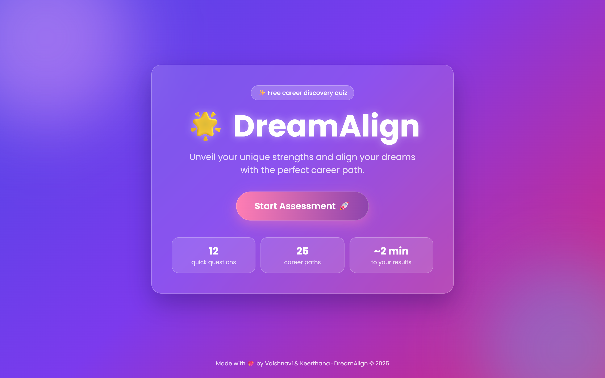
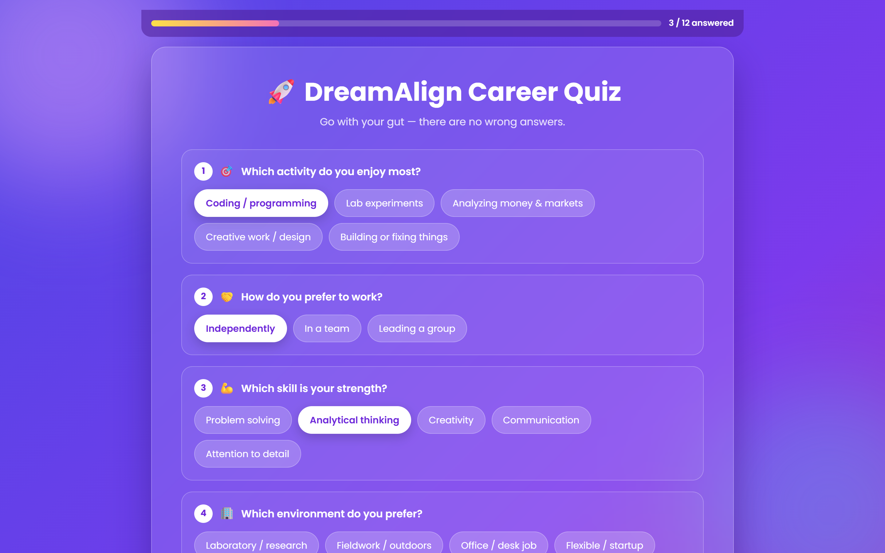
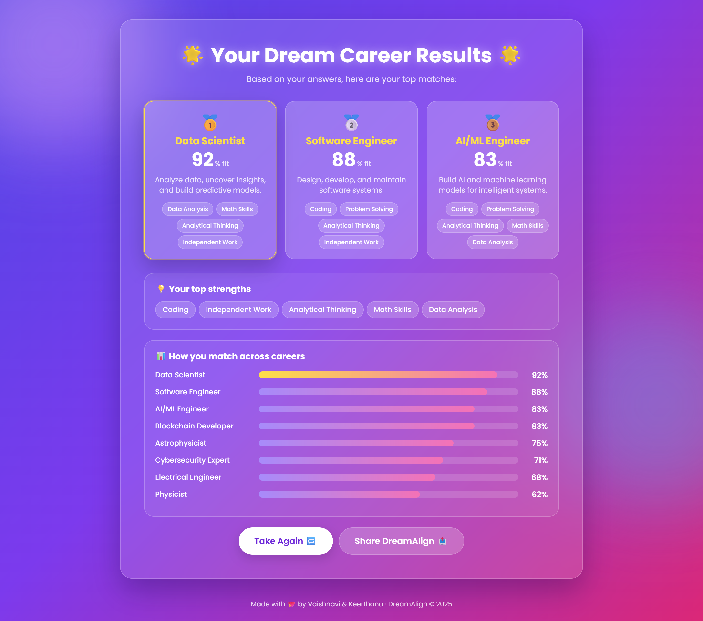
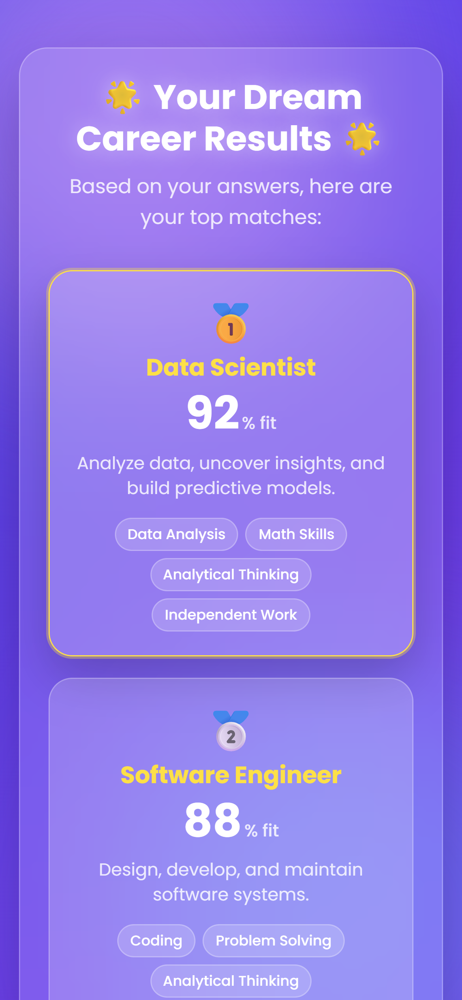

# 🌟 DreamAlign — Discover Your Perfect Career

**Live demo → [dreamalign.vercel.app](https://dreamalign.vercel.app)**

DreamAlign is a career-discovery web app. Answer 12 quick questions about what you enjoy and how you like to work, and it matches your strengths against 25 career paths, from AI/ML Engineer to UX Designer to Astrophysicist.



## Features

- **12-question quiz** with tap-friendly answer chips and a live progress bar
- **Trait-based matching:** every answer adds points to traits (Coding, Leadership, Research, Creativity, …), and each career gets a **% fit** score based on the traits it needs
- **Top 3 matches** with descriptions and the traits that drove each match
- **Your top strengths**, plus a bar chart of how you match across careers
- **Share button** (native share on phones, copy-link on desktop)
- Fully responsive glassmorphism UI with no CSS framework

| Quiz | Results |
|---|---|
|  |  |

<p align="center"></p>

## Tech stack

- **Backend:** Python, Flask
- **Frontend:** Jinja2 templates, HTML, CSS, vanilla JavaScript
- **Hosting:** Vercel

## Run locally

```bash
python -m venv venv
venv\Scripts\activate        # macOS/Linux: source venv/bin/activate
pip install -r requirements.txt
flask --app app run --debug
```

Then open http://127.0.0.1:5000.

## How the matching works

Each quiz option awards points to one or more traits. A trait's strength is your points divided by the maximum points the quiz can give that trait. A career's **fit %** is the average strength across the traits that career needs. Careers are ranked by fit, and ties are broken alphabetically.

To add a career or a question, edit `CAREERS` or `QUESTIONS` in [`app.py`](app.py). On startup the app checks that every career trait is measured by at least one question.

## Authors

Made with 💖 by **Vaishnavi** & **Keerthana**
